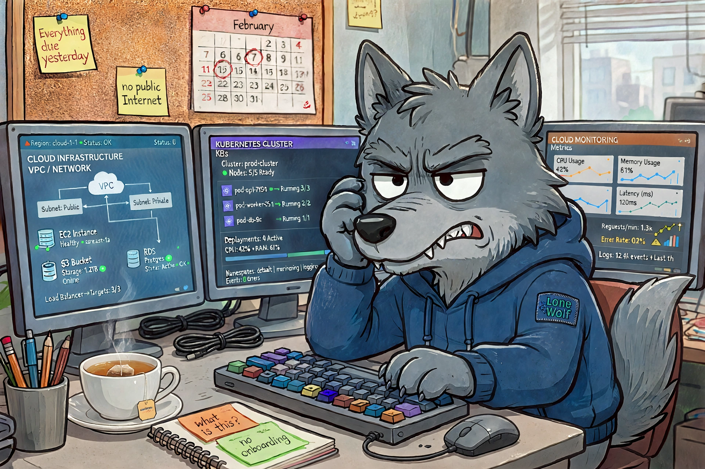
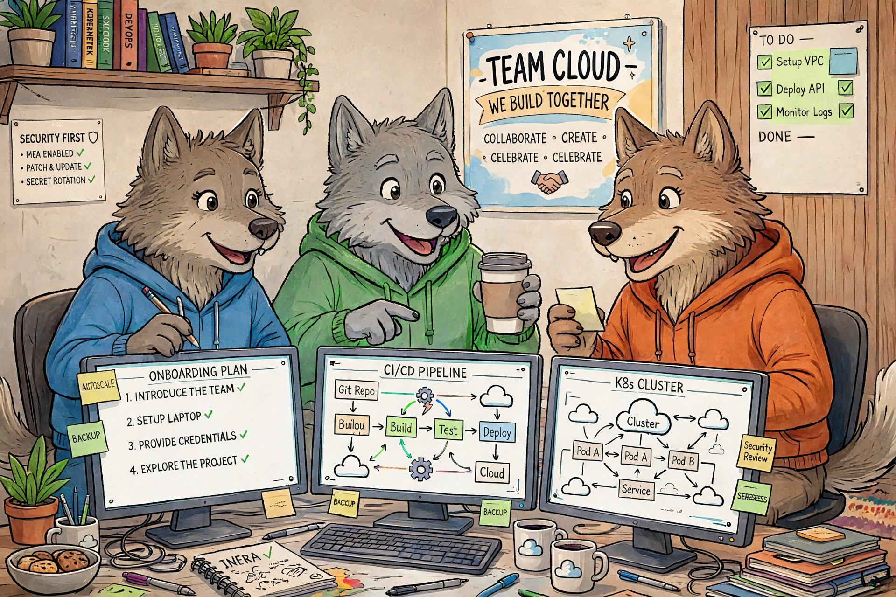

### Requirements: 
- Self-starter who thrives in ambiguity 💪
- Strong howling-into-the-abyss skills 📢
- Years of experience in everything 📚
### Benefits include: ✨ ✨ ✨ 
- A very cool nickname ✅
- Self-guided onboarding ✅
- Dynamic, fast-paced headaches ✅

---

If you’re ever offered the role of **"lone wolf"**, take it as a warning, not a challenge. 

I'll admit it: the first time I heard it, I thought it sounded cool. Independent. Trusted. A little mysterious. However, nobody mentioned that wolves are famously bad at getting access to the public internet. 

I should have been asking myself: "Why is there a need for a lone wolf anyway? Wouldn't it be better to have a harmonized pack?"

## Spotting the Lone Wolf in the Wild 

If you're not blatantly told you're a lone wolf, look for these signs:

- There is no official onboarding plan 
- Documentation may exist, but it's likely outdated
- Basic permissions require three tickets and one person who is on vacation
- Convoluted workarounds are praised   *and you’ve somehow found the Shadow IT Pack*

## Lone Wolf Survival Tips

If you find yourself being the lone wolf, be careful that you're not also the single point of failure. 

1. **Document as you go.** Keep notes about workarounds, requests, and current progress.
2. **Ask persistently, escalate early.** Nobody else is going to follow up for you, and blockers rarely disappear on their own.
3. **Prevent instead of firefight.** Heroic saves get praised, but they don't fix broken processes, and they eventually burn you out.
4. **Aim for best practices, but don't wait for perfect.** A good-enough fix that ships beats a perfect one stuck in review. Just accept that the company may never come back to improve it.
5. **Collect allies and build your pack.** Find the other people who are also figuring it out. Swap stories, celebrate wins, and share your clever fixes.

Do what you can to survive in the meantime. Your ultimate goal should be to join or create a pack. 

## For the Team Lead Reading This

Ask yourself why you wanted a lone wolf in the first place, and whether they're set up for success. A few honest questions:

- Why is there no onboarding?
- Can you make documentation and onboarding plans part of their delivery?
- Can they get the access they need in days, not weeks? *(Or even months...)*
- Who do they ask when they're stuck, and do they know that person's name?
- What happens to the deadline when the unexpected shows up? *(and it will)*
- If they were out for two weeks, who could cover for them?

## Wolves Hunt Better in Packs

A lone wolf shouldn't stay lonely for long. Expand the pack until the territory is shared knowledge, the workload is split, and the work keeps going when one member is out.

So if someone offers you the lone wolf role, ask what the pack looks like. If there isn't one, you've just learned something valuable about the job before your first day.

<em>Please enjoy the AI wolf photo slop. Spot the hallucinations for bonus points.</em>