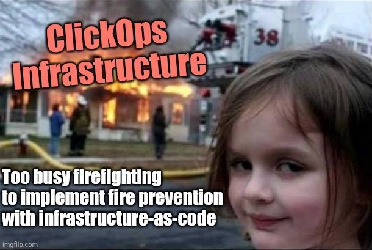

Somebody changed a firewall rule on a Friday.  Nobody knows **who**. Nobody knows **why**.

Working with Cloud Service Providers can be quite complex, and improperly managed resources cause havoc and growing cloud costs. So what can we do about this?

## What is ClickOps?
*ClickOps* is a slang term for manually managing and configuring cloud infrastructure by clicking through the cloud provider's web console.  

Manual changes require manually keeping track of what has happened over time. This becomes increasingly difficult as more time passes, the team members change and various system decisions are made which cannot clearly be seen in the console. You can use cloud logs to hunt for this information, but a repository simply makes this much easier to track and approve. Growing costs are another issue as resources are forgotten and not properly managed or deleted. 

This is why we must balance what should be done manually, versus what could be handled with code. Problems usually start when ClickOps is favored due to improper development standards or deadline pressure.

However, as we know, "There is nothing more permanent than a temporary solution." So, we must ask ourselves if temporary ClickOps solutions are necessary, and whether we will realistically track them. Do we know **who** changed what and **why**?

### Use ClickOps for:
**Securing CI/CD Pipeline Permissions**
Something has to create the pipeline's identity before the pipeline can run. Many teams prefer that the pipeline can't modify its own permissions, in case someone gains access to the repository.

**Prototyping and Learning About the Cloud Service Provider**
When you are first learning about a Cloud Provider, it is important to navigate through their console and understand the system. This is where manually interacting with the cloud console can be beneficial for teams. Once you understand it, write it as code so it doesn’t stay a one-off.

**Addressing Urgent Issues Temporarily**
If there is an urgent issue in production, manually fixing it in the console is sometimes the quickest way to restore service. Click now, then codify it the next day. Otherwise the next `terraform apply` may quietly undo your fix (if your resource is managed by code), and if nobody records it, you’ve created the next ‘Nobody knows who. Nobody knows why.’

## What is Infrastructure-as-Code?

Infrastructure-as-Code, or IaC, means using code to manage and configure cloud infrastructure. Instead of clicking, you describe what you want in files and let a tool build it.

### The main advantages

- **History:** changes live in a repository, so you can see who changed what, and the pull request shows why.
- **Review:** a teammate can check a change before it touches production.
- **Repeatability:** the same code builds the same environment every time, so dev, test, and prod stop drifting apart.
- **Recovery:** if something breaks or disappears, you can rebuild it from code.

[Terraform](https://www.hashicorp.com/en/products/terraform) is one of the most widely used IaC tools and has been around since 2014. It works across Cloud Service Providers and is actively maintained. Learning it takes effort, but it's worth the investment as IaC becomes the standard. 

## Dive into Terraform!

If you are interested in learning Terraform as a beginner, I have a repo that helps guide you through Terraform with GCP. You can use similar principles with AWS or Azure, but you will need to learn about those cloud specific resources on your own. 

[Click here for an Introduction to Terraform on GCP with Self-Paced Modules](https://github.com/VMGranite/gcp-infra-as-code)